# DBスキーマ / ER図

Cloudflare D1(SQLite)に置く全テーブルの構造。マイグレーションは
[workers/api/migrations](../workers/api/migrations) が唯一の正で、この図はその写し。

> [!IMPORTANT]
> **`workers/api/migrations` を変更したら、このファイルのER図も必ず更新すること。**
> 図とスキーマがずれると設計判断の根拠を追えなくなる。

## 前提(このスキーマ特有の事情)

- **`users` テーブルは存在しない。** 認証はCloudflare Accessに一本化しており、認証済みの
  メールアドレスがそのまま各テーブルの `user_id`(= キー)になる。ユーザー登録の仕組みは無く、
  「ユーザー一覧」は `attendance_records` に登場する DISTINCT な `user_id` の集合で代用する。
- **外部キー制約(FK)は無い。** 独自認証を廃止した際([0002_access_auth.sql](../workers/api/migrations/0002_access_auth.sql))、
  `users` への FK ごとテーブルを再構築して制約を外した。テーブル間の関係はすべて
  「同じメールアドレスを共有する」という**論理的な関係**であり、DBが強制するものではない。
- 下図の `USER_EMAIL` は理解を助けるための**概念上のアンカー(物理テーブルではない)**。
  実体は各行の `user_id` / `*_email` 列に入っているメールアドレスそのもの。
- `japan_holidays` だけは全ユーザー共通(グローバル)で、`user_id` を持たない。

## ER図

```mermaid
erDiagram
    USER_EMAIL ||--o{ attendance_records : "user_id"
    USER_EMAIL ||--o{ company_holidays : "user_id"
    USER_EMAIL ||--o{ company_working_days : "user_id"
    USER_EMAIL ||--o| user_settings : "user_id"
    USER_EMAIL ||--o{ account_links : "owner_email (所有者)"
    USER_EMAIL ||--o| account_links : "member_email (参加者/1メール1件)"
    USER_EMAIL ||--o{ link_requests : "requester_email (申請者)"
    USER_EMAIL ||--o{ link_requests : "target_email (承認者)"
    USER_EMAIL ||--o{ agent_connections : "user_email (発行者)"
    USER_EMAIL ||--o{ oauth_codes : "user_email (同意した人)"
    oauth_clients |o--o{ agent_connections : "client_id (DCRのみ・手動はNULL)"
    oauth_clients |o--o{ oauth_codes : "client_id (DCRのみ)"

    USER_EMAIL {
        string email "Cloudflare Access認証のメール（物理テーブルなし・FKなし）"
    }

    attendance_records {
        string user_id PK "メールアドレス"
        string date PK "YYYY-MM-DD"
        string status "office / remote / paidleave"
        string updated_at "ISO8601"
    }

    company_holidays {
        string user_id PK "メールアドレス"
        string date PK "YYYY-MM-DD（会社独自の休日）"
    }

    company_working_days {
        string user_id PK "メールアドレス"
        string date PK "YYYY-MM-DD（土日祝を出勤日に上書き）"
    }

    user_settings {
        string user_id PK "メールアドレス"
        string mandatory_office_day_rules "JSON配列 default '[]'"
        integer target_office_rate "目標出社率 default 50"
        integer closing_day "締め日 0=月末 default 15"
        string closing_day_shift "none / previous / next"
        integer auto_fetch_holidays "0/1 default 1"
        string updated_at "ISO8601"
    }

    japan_holidays {
        string date PK "YYYY-MM-DD（全ユーザー共通・グローバル）"
        string fetched_at "取得日時 ISO8601"
    }

    account_links {
        string owner_email "共有カレンダー本体のメール（indexあり）"
        string member_email PK "参加者のメール（PKにより1メール=1参加）"
        string created_at "ISO8601"
    }

    link_requests {
        string requester_email PK "申請者=本体候補のメール"
        string target_email PK "承認者のメール（indexあり）"
        string created_at "ISO8601"
    }

    agent_connections {
        string id PK "UUID"
        string user_email "発行者のメール（indexあり）"
        string name "一覧での名前"
        string client_id "OAuthのクライアント（CIMDのURLかDCRのID）。NULL=手動発行"
        string access_hash UK "アクセストークンのSHA-256"
        string access_expires_at "ISO8601。NULL=期限なし（手動発行）"
        string refresh_hash UK "リフレッシュトークンのSHA-256"
        string previous_refresh_hash "1つ前のリフレッシュトークン（再利用検知・indexあり）"
        string created_at "ISO8601"
        string last_used_at "ISO8601（90日未使用で失効）"
    }

    oauth_clients {
        string id PK "dcr_で始まるクライアントID"
        string client_name "自己申告の名前"
        string redirect_uris "JSON配列"
        string created_at "ISO8601（未使用のまま30日で削除）"
    }

    oauth_codes {
        string code_hash PK "認可コードのSHA-256"
        string client_id "クライアントID"
        string redirect_uri "戻り先"
        string code_challenge "PKCE S256"
        string user_email "同意した人のメール"
        string name "作る接続の名前"
        string expires_at "ISO8601（60秒）"
    }
```

## テーブル別メモ

| テーブル | 主キー | 役割 |
|---|---|---|
| `attendance_records` | (`user_id`, `date`) | 日ごとの勤怠(出社/在宅/有給) |
| `company_holidays` | (`user_id`, `date`) | 会社独自の休日(平日を休みにする) |
| `company_working_days` | (`user_id`, `date`) | 会社独自の営業日(土日祝を出勤にする) |
| `user_settings` | `user_id` | 目標出社率・締め日などの個人設定(行が無ければ既定値) |
| `japan_holidays` | `date` | 内閣府から取得した日本の祝日(全ユーザー共通) |
| `account_links` | `member_email` | 成立したアカウント連携。`member_email` を本体 `owner_email` に解決する |
| `link_requests` | (`requester_email`, `target_email`) | 未承認の連携申請のみ保持(承認・却下・取消で消える) |
| `agent_connections` | `id` | エージェント接続(OAuthで作ったもの・手動発行のもの)。トークンはハッシュのみ |
| `oauth_clients` | `id` | DCRで登録されたOAuthクライアント(CIMDのクライアントは保存しない) |
| `oauth_codes` | `code_hash` | 未使用の認可コード(60秒・1回限り) |

アカウント連携(`account_links` / `link_requests`)の設計背景は
[docs/adr/0002-account-linking.md](adr/0002-account-linking.md) を参照。
エージェント接続とOAuth(`agent_connections` / `oauth_clients` / `oauth_codes`)の設計背景は
[docs/adr/0004-agent-connections-and-own-oauth-server.md](adr/0004-agent-connections-and-own-oauth-server.md) を参照。
